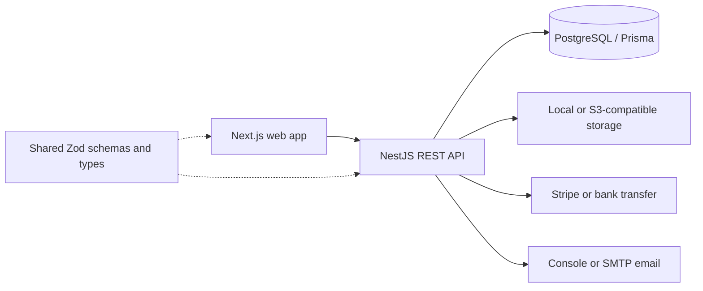

# AI Academy

A cohort-based learning management application for courses on **AI** and
**digital marketing**, with enrollment, assessments, payments, and administration.
The GitHub repository is named `avenir-academy`; the application documentation
currently uses the product label **AI Academy**. “AI” describes the course subject,
not a claim that the learning platform itself uses an AI model.

- Classes run live on Google Meet.
- Students request enrollment and an admin approves it.
- Each monthly module ends with an online test, and passing it unlocks the next module.

The full spec, sprint roadmap and decisions log are in [`docs/PLAN.md`](docs/PLAN.md). Conventions for contributors (human or AI) are in [`CLAUDE.md`](CLAUDE.md).

## Architecture and business workflow



The API separates authentication/users, courses/modules, enrollments, lessons,
assessments/progress, payments, notifications and administration into modules.
Students request enrollment, admins approve it, and learning/assessment rules
control progression. Live sessions link to Google Meet; this is not a video
conferencing implementation.

Payment code includes Stripe checkout/webhooks and bank-transfer administration.
Provider credentials, enabled site settings and operational setup are required;
the presence of the integration does not confirm live payment processing. The
`STRIPE_FAKE` mode is for tests/demos only. Files use local disk in development or
S3-compatible storage with server-side download access checks. Email uses console
output locally or a configured SMTP provider. See `apps/api/.env.example` and
`deploy/.env.production.example` for variable names, never real credentials.

## Quick start

Requires Node 22.12+, pnpm 11 and Docker.

```bash
pnpm install     # dependencies + Prisma client
pnpm bootstrap   # env files, Postgres (docker compose), migrations, seed data
pnpm dev         # web on :3000, API on :4000, shared package watcher
```

Once it's running:

| URL                            | What                                       |
| ------------------------------ | ------------------------------------------ |
| http://localhost:3000/sq       | Landing page (Albanian; `/en` for English) |
| http://localhost:4000/api/v1   | REST API (the web app proxies it)          |
| http://localhost:4000/api/docs | Swagger UI                                 |

**Local development seed accounts only** (password `Password123!`):

| Email                      | Role       | Notes                                       |
| -------------------------- | ---------- | ------------------------------------------- |
| `admin@aiacademy.dev`      | Admin      | Has access to `/admin`                      |
| `instructor@aiacademy.dev` | Instructor | Assigned to every module                    |
| `student1@aiacademy.dev`   | Student    | Approved in AI Foundations, Module 1 active |
| `student2@aiacademy.dev`   | Student    | Pending request for Digital Marketing       |

Do not expose these known-password accounts in a public deployment. Review the
seed and production bootstrap separately, supply unique secrets, and use synthetic
learners for screenshots. In development, emails such as password reset links are
printed in the API log instead of being sent.

### Landing-page content

- **Copy:** `apps/web/messages/sq.json` (Albanian, primary) and `en.json`.
- **Cohort date, schedule, seats, price and contact details:** admin → Site settings (the `SiteSettings` row). No deploy is needed.
- **Course and module names on `/sq`:** the Albanian fields in admin → Courses; empty fields fall back to English.
- **Instructor cards:** instructors fill in their title, bio and photo URL on `/profile` (admins can edit them under Instructors).
- **Testimonials:** admin → Testimonials. Only published, real quotes appear; none are seeded.

## Scripts

| Command           | Description                                                 |
| ----------------- | ----------------------------------------------------------- |
| `pnpm dev`        | Run all apps in watch mode                                  |
| `pnpm build`      | Build every package                                         |
| `pnpm lint`       | ESLint everywhere                                           |
| `pnpm type-check` | TypeScript checks everywhere                                |
| `pnpm test`       | Unit tests (Vitest)                                         |
| `pnpm test:e2e`   | API e2e (`ai_academy_test`) + Playwright (`ai_academy_e2e`) |
| `pnpm db:migrate` | Create or apply Prisma migrations (`prisma migrate dev`)    |
| `pnpm db:seed`    | Re-run the idempotent seed                                  |
| `pnpm db:reset`   | Drop and recreate the dev database, then seed               |
| `pnpm format`     | Prettier                                                    |

## Repository layout

```
apps/web          Next.js 16 (App Router, Tailwind 4, shadcn/ui, TanStack Query)
apps/api          NestJS 12 + Prisma 7 + PostgreSQL 16 (REST under /api/v1)
packages/shared   Enums, zod schemas and API types shared by web and api
deploy/           Production stack: Docker Compose, Caddy, backups
docs/PLAN.md      Spec, roadmap, decisions
docs/DEPLOY.md    Production runbook: server, first deploy, email, analytics, backups, monitoring
```

Run `pnpm build` before `pnpm test:e2e`: Playwright starts the built web app and API itself (stop your dev API on :4000 first). Production deployment is described in [docs/DEPLOY.md](docs/DEPLOY.md).

If port 5432 is already taken on your machine, set `POSTGRES_PORT` (for example `POSTGRES_PORT=5433 pnpm bootstrap`) and update the database URLs in `apps/api/.env`.

## Verification and current status

The repository includes Vitest unit tests, API end-to-end tests and Playwright
browser tests. `.github/workflows/ci.yml` configures formatting, lint, type checks,
tests and a build with PostgreSQL. Test files and workflow configuration do not
establish that a revision passes.

At the October 26, 2026 portfolio review, the latest inspected
[CI run failed](https://github.com/shajrizi2/avenir-academy/actions/runs/38814781305).
The cause was not diagnosed as part of the documentation update. Check
[current Actions results](https://github.com/shajrizi2/avenir-academy/actions)
for newer results before relying on the project.

For local validation, run `pnpm format:check`, `pnpm lint`, `pnpm type-check`,
`pnpm test` and `pnpm build`. End-to-end tests additionally need isolated
PostgreSQL databases and a compatible Chrome installation; inspect
`apps/api/test/setup-env.ts`, `apps/api/test/test-database.ts` and
`apps/web/playwright.config.ts` before running `pnpm test:e2e`.

Deployment workflows and the runbook describe intended operations, not proof of a
live deployment. Review TLS, SMTP, storage, payment configuration, backups and
monitoring for the target environment. Do not publish real learner information,
assessment submissions or payment records in demos or documentation.
